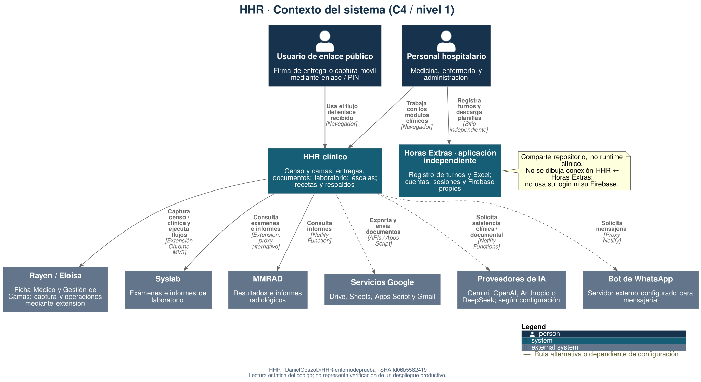
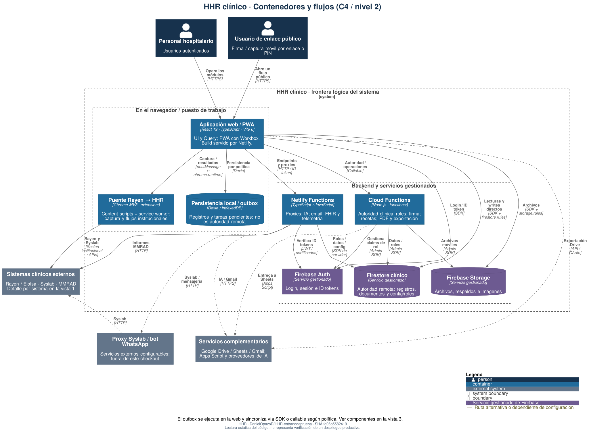
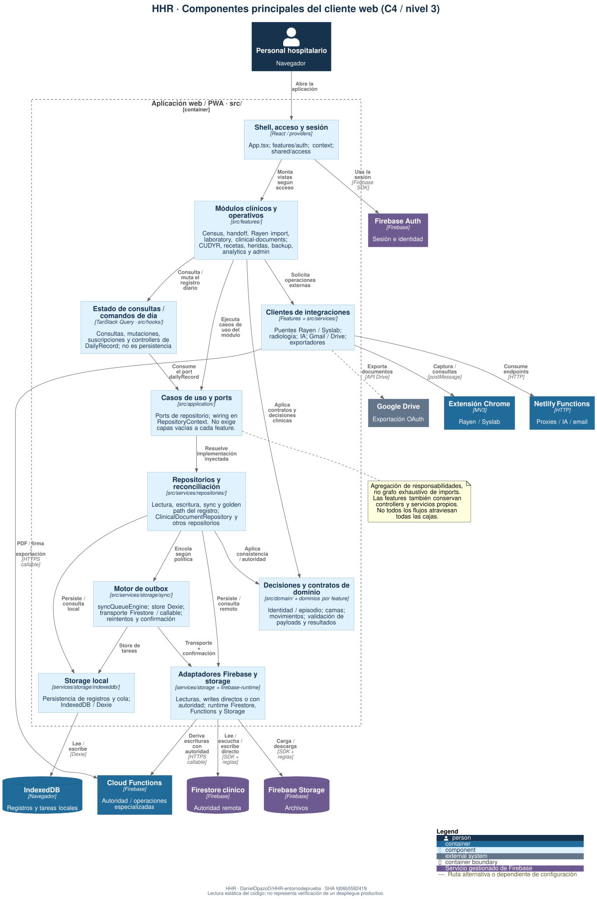
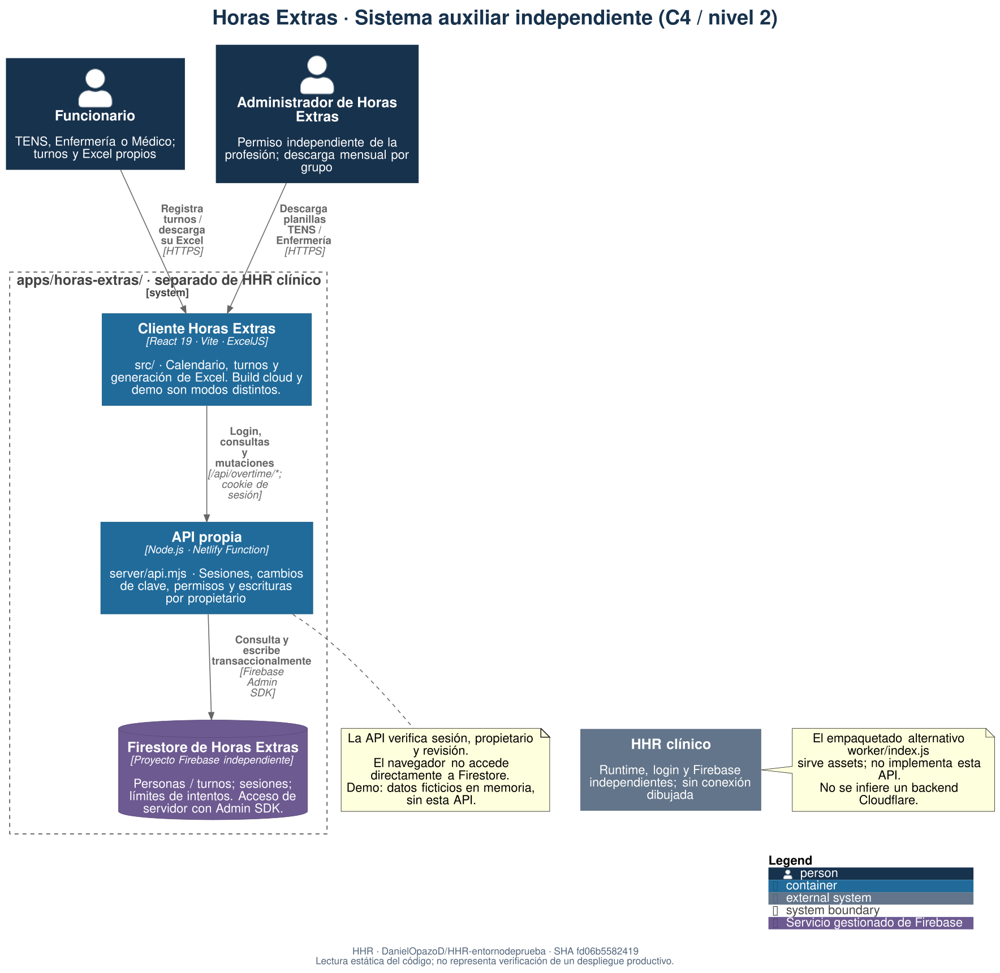

# Mapa arquitectónico C4 de HHR

**Snapshot del código:** [fd06b55824194ad0f8fc5f6d04c31e1c8608c1d3](https://github.com/DanielOpazoD/HHR-entornodeprueba/tree/fd06b55824194ad0f8fc5f6d04c31e1c8608c1d3).
Es la revisión representada en los diagramas, no una afirmación de que describan
cualquier `HEAD` posterior. Los flujos vigentes y sus decisiones siguen gobernados
por la [guía canónica de arquitectura](../../architecture.md) y los ADR.

Mapa condensado basado en lectura estática del repositorio. No acredita despliegue,
certificación clínica ni corrección de los controles de seguridad. No contiene
pacientes, credenciales ni resultados de infraestructura productiva.

## 1. Contexto

Personas, HHR clínico e integraciones externas. Horas Extras comparte repositorio,
pero no login, runtime ni Firebase clínico.



[Abrir SVG](diagrams/01-contexto.svg) · [Editar PlantUML](01-contexto.puml)

## 2. Contenedores

Web/PWA, extensión MV3, IndexedDB/outbox, Functions, Auth, Firestore y Storage.
La frontera HHR es lógica, no un límite físico o una garantía de autorización.
Firestore es autoridad remota; la política del comando determina el orden local/remoto.



[Abrir SVG](diagrams/02-contenedores.svg) · [Editar PlantUML](02-contenedores.puml)

## 3. Componentes web

Responsabilidades agregadas: features, consultas, dominio, ports, repositorios,
outbox y adaptadores. No es un grafo exhaustivo de imports ni obliga a que cada
feature atraviese todas las capas.



[Abrir SVG](diagrams/03-componentes-web.svg) · [Editar PlantUML](03-componentes-web.puml)

## 4. Horas Extras

Sistema auxiliar aislado: cliente, API y proyecto Firestore propios. La demo usa
memoria ficticia; el empaquetado alternativo Cloudflare sirve assets, no implementa
la API nube. Consultar su [guía de nube](../../../apps/horas-extras/cloud-setup.md).



[Abrir SVG](diagrams/04-horas-extras.svg) · [Editar PlantUML](04-horas-extras.puml)

## Lectura y evidencia

- Personas fuera de las fronteras del sistema; flechas para solicitudes/dependencias.
  Se omiten respuestas; web/extensión intercambian mensajes en ambos sentidos.
- Líneas discontinuas: ruta alternativa o dependiente de configuración.
- Cloud Functions usa Admin SDK; las reglas de cliente no sustituyen su autorización.
  Netlify verifica tokens/roles en los endpoints que lo requieren y también puede
  resolver roles por `checkUserRole`; no se dibuja cada dependencia auxiliar.
- Proxies institucionales Syslab y bot WhatsApp: servicios externos configurables,
  no servidores implementados en este checkout. IA depende del proveedor seleccionado.

Fuentes de la revisión representada: [arquitectura](https://github.com/DanielOpazoD/HHR-entornodeprueba/blob/fd06b55824194ad0f8fc5f6d04c31e1c8608c1d3/docs/architecture.md),
[repositorios](https://github.com/DanielOpazoD/HHR-entornodeprueba/blob/fd06b55824194ad0f8fc5f6d04c31e1c8608c1d3/src/services/repositories/README.md),
[storage](https://github.com/DanielOpazoD/HHR-entornodeprueba/blob/fd06b55824194ad0f8fc5f6d04c31e1c8608c1d3/src/services/storage/README.md),
[extensión](https://github.com/DanielOpazoD/HHR-entornodeprueba/blob/fd06b55824194ad0f8fc5f6d04c31e1c8608c1d3/extension/manifest.json),
[Functions](https://github.com/DanielOpazoD/HHR-entornodeprueba/blob/fd06b55824194ad0f8fc5f6d04c31e1c8608c1d3/functions/index.js)
y [Netlify](https://github.com/DanielOpazoD/HHR-entornodeprueba/blob/fd06b55824194ad0f8fc5f6d04c31e1c8608c1d3/netlify.toml).

## Regenerar localmente

Necesarios: Java y Graphviz (`brew install graphviz` en macOS;
`sudo apt install graphviz` en Linux). No se añaden dependencias a la aplicación.
Descargar [PlantUML 1.2024.5](https://github.com/plantuml/plantuml/releases/download/v1.2024.5/plantuml-1.2024.5.jar)
y guardar el JAR en la ruta indicada por `PLANTUML_JAR`. No se incorpora un
renderer ejecutable ni configuración nueva: la regeneración es un procedimiento
manual de documentación.

1. Desde la raíz del repo, comprobar los cinco hashes de C4/licencia contra
   [provenance.json](vendor/provenance.json):

   ```sh
   shasum -a 256 docs/architecture/c4/vendor/*.puml docs/architecture/c4/vendor/LICENSE
   ```

2. Copiar los fuentes, estilo y librería a una carpeta de trabajo fuera del repo:

   ```sh
   mkdir -p "$HOME/hhr-c4-workspace/sources" "$HOME/hhr-c4-workspace/vendor" "$HOME/hhr-c4-workspace/diagrams"
   cp docs/architecture/c4/[0-9][0-9]-*.puml docs/architecture/c4/style.puml "$HOME/hhr-c4-workspace/sources/"
   cp docs/architecture/c4/vendor/*.puml docs/architecture/c4/vendor/LICENSE "$HOME/hhr-c4-workspace/vendor/"
   ```

3. En cada una de las cuatro **copias** numeradas, reemplazar con un editor los
   dos includes remotos por:

   ```plantuml
   !include ../vendor/C4_Container.puml
   !include ../vendor/C4_Component.puml
   ```

   Conservar `!include style.puml`: el estilo se copió a la misma carpeta.
   Los fuentes versionados mantienen los includes remotos exigidos por el playbook;
   las copias de trabajo usan exclusivamente la librería local fijada por hash.

4. Validar sintaxis y generar SVG con las copias locales:

   ```sh
   export PLANTUML_JAR="$HOME/tools/plantuml-1.2024.5.jar"
   java -Djava.awt.headless=true -jar "$PLANTUML_JAR" -charset UTF-8 -DRELATIVE_INCLUDE=1 -failfast2 -checkonly "$HOME/hhr-c4-workspace/sources/"[0-9][0-9]-*.puml
   java -Djava.awt.headless=true -jar "$PLANTUML_JAR" -charset UTF-8 -DRELATIVE_INCLUDE=1 -failfast2 -tsvg -o "$HOME/hhr-c4-workspace/diagrams" "$HOME/hhr-c4-workspace/sources/"[0-9][0-9]-*.puml
   ```

5. Revisar visualmente las cuatro vistas y copiar solo los SVG al repo:

   ```sh
   cp "$HOME/hhr-c4-workspace/diagrams/"*.svg docs/architecture/c4/diagrams/
   ```

GitHub muestra los SVG versionados sin ejecutar herramientas. No se suben JAR,
carpetas de trabajo, PNG, PDF, ZIP ni logs. [LICENSE](vendor/LICENSE) conserva MIT.
El procedimiento local no envía fuentes a un servidor PlantUML. Fonts/Graphviz
pueden cambiar el layout; se verificó Java 17 y Graphviz 16.1.0 en macOS.

## Mantenimiento

Editar el `.puml` dueño del flujo, actualizar el SHA representado en esta guía y
en [style.puml](style.puml), regenerar las cuatro vistas y revisar visualmente el
diff. Los cambios de arquitectura real deben seguir documentándose primero en
la guía canónica/ADR; estos dibujos no reemplazan sus contratos.
